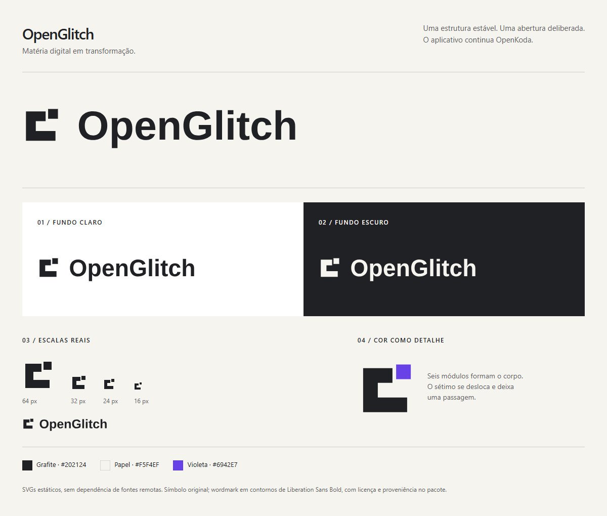

# OpenGlitch — identidade estática

Data: 14 de novembro de 2026. A empresa se chama **OpenGlitch**; o aplicativo permanece **OpenKoda**. Estes arquivos não renomeiam protocolos, rotas, identificadores, integrações nem a identidade visual dentro da demonstração do aplicativo.

## Direção e originalidade

“Matéria digital em transformação” aparece como uma estrutura aberta e um deslocamento deliberado. O símbolo é um portal construído com sete módulos quadrados: seis compõem um corpo contínuo; o sétimo se move para cima e para a direita. O vazio tem uma saída reconhecível. O deslocamento comunica abertura, sem depender de uma ideia de defeito.

Foram observadas as quatro referências fornecidas, incluindo a imagem intitulada `Butterfly _ vasilisa_kon.jpg`. Delas foi extraída a relação entre módulos, densidade, forma e espaço vazio. Não foram reutilizados pixels, composições, borboletas, personagens, frases, símbolos ou marcas-d’água. A geometria do portal foi construída para este projeto.

A linguagem modular fica no símbolo e na arte. O nome usa letras contínuas, sem tremor, separação RGB, ruído, sombra ou animação. A assinatura é inteiramente estática.

## Construção

- Prancheta do símbolo: 32 × 32 unidades.
- Módulo: 8 × 8 unidades.
- Corpo: dois módulos na faixa superior, um no meio à esquerda e três na base.
- Módulo separado: deslocamento de +2 em x e −2 em y, relativo ao canto superior direito da malha.
- O corpo é um único path sem emendas; o módulo separado é outro path. Essa união evita linhas finas acidentais ao rasterizar.
- Assinatura horizontal: 222 × 36 unidades; wordmark de 176 × 31, em x = 46 e y = 2. O símbolo recebe ajuste óptico vertical de −3 unidades para se relacionar à altura das maiúsculas, sem acompanhar a descendente do “p”.
- Área de respiro externa recomendada: pelo menos um módulo de 8 unidades, proporcional à escala usada.
- Assinatura horizontal recomendada a partir de aproximadamente 150 px de largura. Abaixo disso, preferir o símbolo. No cabeçalho, 166,5 × 27 px mantém a proporção nativa.

Os favicons de 16 e 24 px têm coordenadas próprias em pixels inteiros. Mantêm a abertura e o módulo separado; não são apenas reduções fracionárias do desenho de 32 px.

## Arquivos entregues

Todos estão em [`OpenKoda/site/dist/brand/`](../../site/dist/brand/).

| Arquivo | Uso |
| --- | --- |
| `openglitch-lockup.svg` | Símbolo e nome, `currentColor`, para SVG inline |
| `openglitch-lockup-ink.svg` | Assinatura grafite, fundo transparente |
| `openglitch-lockup-paper.svg` | Assinatura branca suave, fundo transparente |
| `openglitch-wordmark.svg` | Apenas o nome em paths, `currentColor` |
| `openglitch-symbol.svg` | Símbolo, `currentColor` |
| `openglitch-symbol-ink.svg` | Símbolo grafite |
| `openglitch-symbol-paper.svg` | Símbolo branco suave |
| `openglitch-symbol-accent.svg` | Corpo grafite e módulo violeta, para fundo claro |
| `openglitch-symbol-accent-paper.svg` | Corpo branco suave e módulo violeta claro, para fundo escuro |
| `favicon.svg` | Favicon de 32 unidades com superfície opaca clara |
| `favicon-24.svg`, `favicon-16.svg` | Favicons com ajuste para a grade de pixels |
| `favicon-16.png`, `favicon-24.png`, `favicon-32.png` | Rasterizações nos tamanhos reais, sem interpolação posterior |
| `preview.html`, `preview.png` | Prancha de revisão: assinatura, fundos claro/escuro e escalas reais |
| `provenance.json` | Fonte, hash, medidas e cores |
| `LICENSE-Liberation.txt` | Licença integral da fonte de origem |
| `build-brand.ps1` | Fonte executável da construção vetorial |
| `render-brand.mjs` | Renderização local de revisão, usando Playwright já existente no projeto |



## Cor e aplicação

| Função | Cor | Aplicação |
| --- | --- | --- |
| Grafite | `#202124` | Marca principal, texto, ações principais |
| Papel | `#F5F4EF` | Fundo claro; marca invertida em superfícies escuras |
| Violeta | `#6942E7` | Módulo de assinatura e acentos localizados em fundo claro |
| Violeta claro | `#B8A4FF` | Acento equivalente sobre grafite |

Contrastes calculados pela luminância relativa sRGB: grafite/papel **14,62:1**; violeta/papel **5,40:1**. O violeta principal contra grafite fica em **2,71:1**, por isso ele não deve ser usado como texto ou indicador funcional sobre esse fundo. Nessa situação, usar a variante clara. Nenhuma informação deve depender somente de cor.

Para inserir a marca via ``, usar a versão `-ink` ou `-paper`, com `alt="OpenGlitch"` e dimensões proporcionais. O arquivo em `currentColor` é destinado a uso inline: o CSS da página não atravessa automaticamente um `` para recolorir seu conteúdo. Em link que já tenha nome acessível “OpenGlitch, início”, o SVG pode receber `aria-hidden="true"` para evitar leitura duplicada. A área clicável deve ter pelo menos 44 × 44 px, independente do tamanho visível da marca.

Não colocar número de versão do aplicativo dentro do wordmark da empresa. “OpenKoda” e sua versão podem aparecer em um contexto separado de produto. Não adicionar animação contínua ao cabeçalho.

## Tipografia, licença e reprodução

O site existente usa uma pilha de fontes do sistema (`Segoe UI Variable Text`, `Segoe UI`, Arial). Não foi encontrada uma fonte de marca OFL nos arquivos do site. A fonte disponível para uso no wordmark foi identificada em:

`OpenKoda/app/security-runtime/node_modules/pdfjs-dist/standard_fonts/LiberationSans-Bold.ttf`

Família: **Liberation Sans Bold**. SHA-256 do arquivo utilizado:

`361c61b82d575c5c35fd9157fda8b0194bcfcd0d88ea8521a4fb5dd53d33dddc`

A licença local dessa versão é **GPL v2 com a exceção de incorporação em documentos da Liberation**, e não SIL OFL. Ela está preservada integralmente em `LICENSE-Liberation.txt`, com o aviso de copyright da Red Hat. Sua cláusula 1(a) trata da incorporação da fonte ou de partes inalteradas em documentos. O wordmark contém os contornos das dez letras, sem modificação dos desenhos dos glifos; houve apenas escala uniforme e posicionamento da inscrição.

Não foi convertida nem redistribuída uma fonte proprietária. Os SVGs não contêm arquivo de fonte, CSS remoto, `<text>`, imagens raster, filtros, scripts ou referências externas. O símbolo é geometria original; o lettering tem a proveniência identificada acima. Não se trata de uma nova família tipográfica ou de uma pesquisa de disponibilidade de marca.

Para reconstruir em Windows com as dependências locais existentes:

```powershell
& OpenKoda/site/dist/brand/build-brand.ps1
node OpenKoda/site/dist/brand/render-brand.mjs
```

O primeiro comando carrega explicitamente a fonte local com `PrivateFontCollection`; falha se o arquivo ou a família esperada não estiverem presentes. O segundo usa Edge sem janela para gerar a prancha e os PNGs. A geração não instala fontes nem altera a interface do aplicativo.

## Verificação

- Prancha renderizada no Edge e inspecionada visualmente: proporções, respiro, claro/escuro e legibilidade da assinatura.
- Símbolo observado em 64 px; favicons observados em 16, 24 e 32 px, em tamanho real.
- Coordenadas dos favicons alinhadas a pixels inteiros; ícones mantêm passagem visível e módulo separado.
- Contraste da paleta calculado; uso do violeta em fundo escuro distinguido explicitamente.
- SVGs analisados como XML, sem dependência de fontes ou recursos remotos.
- A marca permanece legível sem movimento, JavaScript ou renderizador Canvas.

Esta verificação cobre os arquivos de marca. Integração, cabeçalho responsivo e arte do site devem ser verificados no contexto final pelo responsável pela página.
