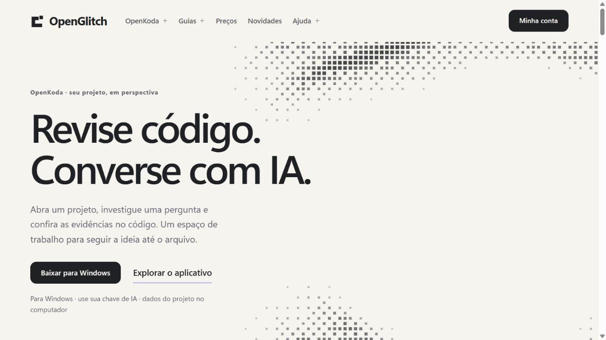

# OpenGlitch — publicação e validação do site

Data: 14 de novembro de 2026. Empresa: OpenGlitch. Aplicativo: OpenKoda.
Provedor gerenciado da assinatura: Koda.

## Publicação

- Site: https://openkoda-desktop.steelyrowan1.chatgpt.site/
- Projeto Sites: `appgprj_6af78884a914819192bbd9656c1c264b`.
- Versão: 16, `appgprj_6af78884a914819192bbd9656c1c264b~appgver_88c49d78c7f88191b0dff19fba86e474`.
- Commit do repositório de publicação: `17b89d94294176a41724f90e790e83c0328b0204`.
- Deployment: `appgdep_6af8b428b3388191954308b762d99b17`, `succeeded` às 19:19:18 UTC.
- Arquivo de publicação: 4.536.320 bytes, 70 arquivos.
- SHA-256 do arquivo: `67f1767e2aa8542eb5dbdb4ef2f28d8021562f448b9257dea3c447007c647c8d`.
- Visibilidade pública existente preservada.

## Resultado

Identidade editorial em papel, grafite e violeta; símbolo modular original;
abertura e encerramento com composição de módulos em largura total. Os estilos
se estendem às páginas existentes, preservando conteúdo, rotas, componentes
interativos e o aplicativo demonstrativo em seu iframe isolado. A aparência
clara, escura e do sistema continua disponível no rodapé.

O Canvas só anima durante interação e acomodação. Há limites de densidade,
resolução e deslocamento, pausa fora da tela e limpeza dos observadores.
Os SVGs estáticos mantêm a composição sem o módulo de animação. No celular,
a área de leitura permanece livre da textura.

## Verificações

### Automação

`node --test tests/*.test.mjs`, em `OpenKoda/site`, aprovou 22 testes dos
arquivos `worker-session`, `download`, `demo-security`, `product-links` e
`matter-field`. Após corrigir o contêiner de fundo do encerramento, foram
repetidos os 11 testes de `product-links` e `matter-field`, todos aprovados.

As verificações cobrem sessão e proteção de rotas, download parcial, isolamento
da demonstração, referências entre páginas e assets, limites do motor visual,
pausa, limpeza, mudanças de tema/tamanho, toque, movimento reduzido e falhas.
Sintaxe JavaScript, análise dos estilos e verificação de whitespace passaram.

### Navegador real

- Abertura em 390, 1280, 1440 e 1920 px; preços também em 320 e 768 px.
- Sem transbordamento horizontal nas larguras estreitas verificadas.
- Ponteiro altera as próprias marcas, com retorno ao repouso.
- Tema escuro persiste ao navegar; tema claro e preferência do sistema funcionam.
- Menu móvel abre, fecha e navega para preços.
- Teclado alterna entre as abas de conexão e atualiza a seleção acessível.
- Preferências de cookies reabrem e a escolha persiste após recarregar.
- Guia de primeiro projeto conserva imagem, índice e leitura.
- Demonstração aceita pergunta, mostra processamento e resposta preparada;
  reiniciar restaura os exemplos. Nenhuma chamada de IA foi feita.
- A versão publicada mostra OpenGlitch na página inicial e na conta.
- A tela pública de entrada renderizou os formulários e o Turnstile mostrou
  “Sucesso!”. Não foi feito novo login, cadastro ou envio de e-mail pessoal.
- Fallback estático conferido em uma cópia local sem os dois módulos de animação.

Amostra local de cadência dos frames: 241 intervalos em uma janela de 2,2 s,
mediana 8 ms, p95 16,1 ms, zero intervalos acima de 50 ms. É um ensaio curto no
navegador deste computador, não uma garantia de desempenho universal nem uma
medição isolada de custo de CPU do Canvas.

### Download publicado

Requisição `GET /download/windows` com `Range: bytes=0-1`:

- HTTP 206.
- `Content-Range: bytes 0-1/182164978`.
- Dois bytes recebidos: `4D-5A` (assinatura MZ de executável).
- Tempo observado: 1.077 ms.

Isso confirma a rota e o download parcial do instalador 1.1.1, não um novo
download completo ou instalação. Os arquivos do aplicativo não foram alterados
por esta reformulação do site.

## Limites e pendências

- Validar em hardware móvel real e com movimento reduzido ativo no sistema.
- Login pessoal completo não foi repetido nesta publicação; os testes de sessão
  passaram e a tela pública com CAPTCHA foi conferida.
- `openglitch.com.br`: ainda depende de DNS, emissão de HTTPS e validação das
  origens de autenticação, Turnstile e e-mail. Ver `../DOMINIO-OPENGLITCH.md`.
- Atualização instalada 1.1.0 → 1.1.1 ainda não ensaiada nesta etapa; rollout
  automático permanece pausado. Ver evidências da release desktop separadas.
- Asaas permanece para uma próxima etapa.

Consumo de APIs de IA nesta reformulação e validação: **US$ 0**.
